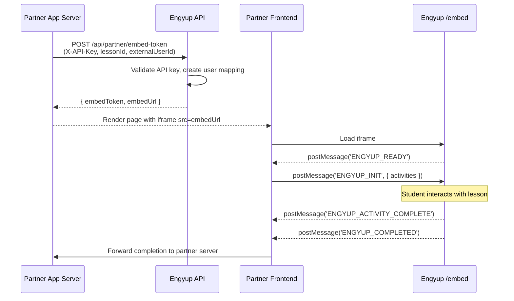
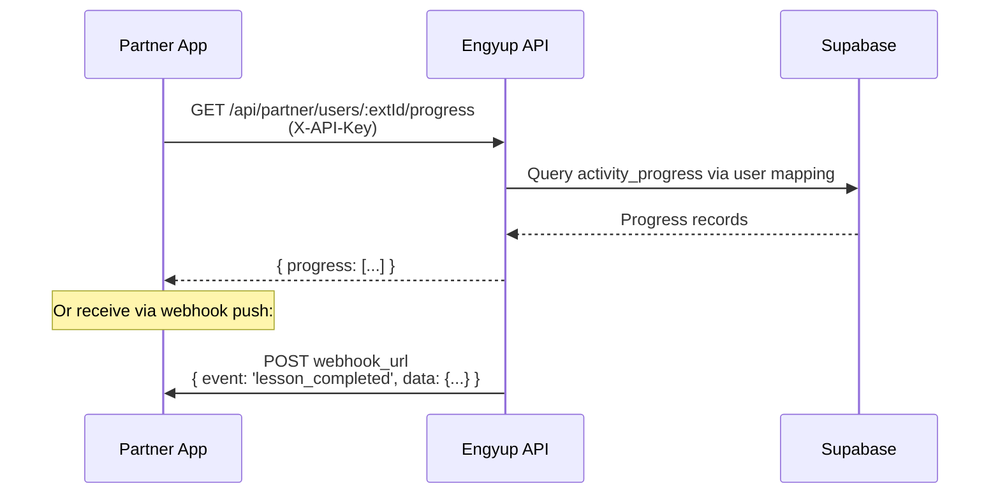

# Integration Plan: Render Engyup Lessons on External Apps

## Goal

Enable third-party apps to **render Engyup lessons** and **sync user interaction data** back to Engyup, with proper authentication, authorization, and progress tracking.

## Current State Analysis

Your app already has a basic foundation:

| What exists | Status | Gap |
|---|---|---|
| [EmbedLessonView](file:///home/harby/projects/engyup/src/pages/EmbedLessonView.tsx) | ✅ Works via iframe + `postMessage` | ❌ No auth, no API keys, no progress sync |
| [Event tracking](file:///home/harby/projects/engyup/src/services/eventService.ts) | ✅ xAPI statements | ❌ Requires Supabase session (internal only) |
| [Server API](file:///home/harby/projects/engyup/server.ts) | ✅ Express endpoints | ❌ No partner/app API, no API key auth |
| [Roles](file:///home/harby/projects/engyup/src/types/supabase.ts#L56) | ✅ `student/teacher/super_admin` | ❌ No `app` or `partner` role |

## User Review Required

> [!IMPORTANT]
> **Choosing the right architecture is the most critical decision.** I'm recommending a **hybrid approach** (Option C below). Please review all three options and confirm before I proceed.

## Architecture Options Comparison

### Option A: Pure REST API Only
```
Partner App Server ──HTTP──▶ Engyup API ──▶ Supabase
```
- Partner fetches lesson JSON, builds their **own** renderer
- **Pros**: Maximum flexibility for partners, clean separation
- **Cons**: Partners must rebuild 20+ activity renderers (MCQ, flashcard, gap-fill, etc.) — **massive effort** and inconsistent UX

### Option B: Pure Embeddable Widget (iframe)
```
Partner App ──iframe──▶ Engyup /embed ──postMessage──▶ Partner App
```
- Partner embeds Engyup's lesson player in an iframe
- **Pros**: Zero rendering work for partners, consistent UX
- **Cons**: Limited customization, iframe security constraints, can't do server-to-server progress sync reliably

### Option C: Hybrid — REST API + Embeddable Widget ⭐ RECOMMENDED
```
┌─────────────────────────────────────────────────────────┐
│                    Partner App                          │
│                                                         │
│  Server-side:                    Client-side:           │
│  ┌──────────────┐                ┌──────────────────┐   │
│  │ Partner API  │──API Key──▶    │ Embedded iframe  │   │
│  │              │    Engyup API  │ (lesson player)  │   │
│  │ • Get lessons│                │                  │   │
│  │ • Sync users │                │ postMessage ◀──▶ │   │
│  │ • Read stats │                │ progress events  │   │
│  └──────────────┘                └──────────────────┘   │
│                                         │               │
│                                         ▼               │
│                                  Engyup Webhook         │
│                                  (progress callback)    │
└─────────────────────────────────────────────────────────┘

                        │
                        ▼
              ┌──────────────────┐
              │   Engyup API     │
              │                  │
              │ /api/partner/*   │
              │ • Lessons CRUD   │
              │ • Progress sync  │
              │ • User mapping   │
              │ • Stats/reports  │
              └──────────────────┘
                        │
                        ▼
              ┌──────────────────┐
              │    Supabase      │
              │ • partner_apps   │
              │ • partner_users  │
              │ • activity_prog  │
              │ • xapi_stmts     │
              └──────────────────┘
```

**Why Hybrid is best:**
1. Partners get the **full lesson player** via iframe (no need to rebuild 20+ renderers)
2. Server-side API for **user mapping, progress queries, and bulk operations**
3. **Webhook callbacks** push real-time progress to partners (not just polling)
4. API keys provide proper **app-level auth** without exposing Supabase credentials
5. You maintain **full control** over the rendering experience

---

## Open Questions

> [!IMPORTANT]
> **Q1**: Do the partner apps have their own user accounts? If yes, we need a **user mapping** table (`partner_user_id ↔ engyup_user_id`). If partner users are anonymous, we can use session tokens instead.

> [!IMPORTANT]
> **Q2**: Should partners be able to access **all** lessons, or only specific courses you assign to them? This affects the access control model.

> [!IMPORTANT]
> **Q3**: Do you want to charge partners per-API-call or just track usage? This affects whether we need rate limiting and usage metering.

> [!WARNING]
> **Q4**: The current [EmbedLessonView](file:///home/harby/projects/engyup/src/pages/EmbedLessonView.tsx) has **zero authentication** — anyone can load `/embed` and inject lesson data. We need to secure this regardless of which option you choose.

---

## Proposed Changes (Option C: Hybrid)

### Component 1: Database Schema — New Tables

#### [NEW] Migration: `partner_apps` table
Stores registered partner applications with API keys.

```sql
-- Partner applications registry
CREATE TABLE IF NOT EXISTS partner_apps (
  id UUID PRIMARY KEY DEFAULT gen_random_uuid(),
  name TEXT NOT NULL,
  slug TEXT NOT NULL UNIQUE,  -- e.g. 'schoology', 'my-tutor-app'
  api_key TEXT NOT NULL UNIQUE DEFAULT encode(gen_random_bytes(32), 'hex'),
  api_secret TEXT NOT NULL DEFAULT encode(gen_random_bytes(32), 'hex'),
  webhook_url TEXT,           -- URL to POST progress events to
  allowed_origins TEXT[],     -- CORS origins for iframe embedding
  allowed_courses TEXT[],     -- Course IDs this partner can access (NULL = all)
  is_active BOOLEAN DEFAULT true,
  rate_limit_per_hour INTEGER DEFAULT 1000,
  metadata JSONB DEFAULT '{}',
  created_at TIMESTAMPTZ DEFAULT now(),
  updated_at TIMESTAMPTZ DEFAULT now()
);

-- Map partner users to Engyup users (or create shadow accounts)
CREATE TABLE IF NOT EXISTS partner_user_mappings (
  id UUID PRIMARY KEY DEFAULT gen_random_uuid(),
  partner_app_id UUID REFERENCES partner_apps(id) ON DELETE CASCADE,
  external_user_id TEXT NOT NULL,       -- User ID in the partner's system
  engyup_user_id UUID REFERENCES auth.users(id),  -- Mapped Engyup user (nullable for lazy creation)
  display_name TEXT,
  metadata JSONB DEFAULT '{}',
  created_at TIMESTAMPTZ DEFAULT now(),
  UNIQUE(partner_app_id, external_user_id)
);

-- Track API usage for rate limiting and analytics
CREATE TABLE IF NOT EXISTS partner_api_logs (
  id BIGSERIAL PRIMARY KEY,
  partner_app_id UUID REFERENCES partner_apps(id),
  endpoint TEXT NOT NULL,
  method TEXT NOT NULL,
  status_code INTEGER,
  response_time_ms INTEGER,
  created_at TIMESTAMPTZ DEFAULT now()
);

-- Index for rate limiting lookups
CREATE INDEX idx_partner_api_logs_rate ON partner_api_logs (partner_app_id, created_at);
CREATE INDEX idx_partner_user_mappings_lookup ON partner_user_mappings (partner_app_id, external_user_id);
```

#### [NEW] Migration: RLS Policies
```sql
-- partner_apps: only service role can manage
ALTER TABLE partner_apps ENABLE ROW LEVEL SECURITY;
CREATE POLICY "Service role manages partner_apps"
  ON partner_apps FOR ALL
  USING (auth.role() = 'service_role');

-- partner_user_mappings: only service role
ALTER TABLE partner_user_mappings ENABLE ROW LEVEL SECURITY;
CREATE POLICY "Service role manages partner_user_mappings"
  ON partner_user_mappings FOR ALL
  USING (auth.role() = 'service_role');
```

---

### Component 2: API Key Authentication Middleware

#### [NEW] `src/middleware/partnerAuth.ts`
New middleware that validates API keys for partner endpoints.

```typescript
import { createClient } from '@supabase/supabase-js';

interface PartnerApp {
  id: string;
  name: string;
  slug: string;
  allowed_origins: string[] | null;
  allowed_courses: string[] | null;
  is_active: boolean;
  rate_limit_per_hour: number;
  webhook_url: string | null;
}

export const authenticatePartner = (supabaseAdmin: any) => {
  return async (req: any, res: any, next: any) => {
    // Extract API key from header
    const apiKey = req.headers['x-api-key'];
    if (!apiKey) {
      return res.status(401).json({ error: 'Missing X-API-Key header' });
    }

    // Look up partner app
    const { data: partner, error } = await supabaseAdmin
      .from('partner_apps')
      .select('*')
      .eq('api_key', apiKey)
      .eq('is_active', true)
      .maybeSingle();

    if (error || !partner) {
      return res.status(401).json({ error: 'Invalid or inactive API key' });
    }

    // Check rate limit
    const oneHourAgo = new Date(Date.now() - 3600000).toISOString();
    const { count } = await supabaseAdmin
      .from('partner_api_logs')
      .select('*', { count: 'exact', head: true })
      .eq('partner_app_id', partner.id)
      .gte('created_at', oneHourAgo);

    if ((count || 0) >= partner.rate_limit_per_hour) {
      return res.status(429).json({ error: 'Rate limit exceeded' });
    }

    // Attach partner to request
    req.partner = partner;
    next();
  };
};
```

---

### Component 3: Partner REST API Endpoints

#### [MODIFY] `server.ts` and `api/index.ts`
Add new `/api/partner/*` routes:

```typescript
// ═══════════════════════════════════════════
// PARTNER API ROUTES (API Key authenticated)
// ═══════════════════════════════════════════

// 1. GET /api/partner/lessons — List available lessons
app.get('/api/partner/lessons', authenticatePartner(supabaseAdmin), async (req, res) => {
  const partner = req.partner;
  const { courseId, gradeId } = req.query;

  let query = supabaseAdmin
    .from('lessons')
    .select('id, title, module_id, order_index, description, objectives');

  // If partner has course restrictions, enforce them
  if (partner.allowed_courses?.length) {
    // Get modules for allowed courses
    const { data: modules } = await supabaseAdmin
      .from('modules')
      .select('id')
      .in('course_id', partner.allowed_courses);
    const moduleIds = (modules || []).map(m => m.id);
    query = query.in('module_id', moduleIds);
  }

  if (courseId) {
    const { data: modules } = await supabaseAdmin
      .from('modules')
      .select('id')
      .eq('course_id', courseId);
    query = query.in('module_id', (modules || []).map(m => m.id));
  }

  const { data, error } = await query.order('order_index');
  if (error) return res.status(500).json({ error: error.message });

  // Log API usage
  await supabaseAdmin.from('partner_api_logs').insert([{
    partner_app_id: partner.id, endpoint: '/api/partner/lessons',
    method: 'GET', status_code: 200
  }]);

  res.json({ success: true, lessons: data });
});

// 2. GET /api/partner/lessons/:id/activities — Get full lesson with activities
app.get('/api/partner/lessons/:id/activities', authenticatePartner(supabaseAdmin), async (req, res) => {
  const { id } = req.params;

  const { data: activities, error } = await supabaseAdmin
    .from('activities')
    .select('*')
    .eq('lesson_id', id)
    .order('order_index');

  if (error) return res.status(500).json({ error: error.message });
  res.json({ success: true, activities });
});

// 3. POST /api/partner/embed-token — Generate a signed embed token
app.post('/api/partner/embed-token', authenticatePartner(supabaseAdmin), async (req, res) => {
  const { lessonId, externalUserId, displayName } = req.body;
  const partner = req.partner;

  // Create or find user mapping
  let { data: mapping } = await supabaseAdmin
    .from('partner_user_mappings')
    .select('*')
    .eq('partner_app_id', partner.id)
    .eq('external_user_id', externalUserId)
    .maybeSingle();

  if (!mapping) {
    const { data: newMapping } = await supabaseAdmin
      .from('partner_user_mappings')
      .insert([{
        partner_app_id: partner.id,
        external_user_id: externalUserId,
        display_name: displayName
      }])
      .select()
      .single();
    mapping = newMapping;
  }

  // Generate a short-lived embed token (HMAC-signed)
  const payload = {
    partnerId: partner.id,
    lessonId,
    externalUserId,
    mappingId: mapping.id,
    exp: Date.now() + 3600000 // 1 hour
  };

  const token = Buffer.from(JSON.stringify(payload)).toString('base64url');
  // In production: sign with HMAC using partner.api_secret

  res.json({ success: true, embedToken: token, embedUrl: `/embed?token=${token}` });
});

// 4. POST /api/partner/progress — Submit progress from partner
app.post('/api/partner/progress', authenticatePartner(supabaseAdmin), async (req, res) => {
  const { externalUserId, activityId, status, score, timeSpentSeconds } = req.body;
  const partner = req.partner;

  // Resolve user mapping
  const { data: mapping } = await supabaseAdmin
    .from('partner_user_mappings')
    .select('engyup_user_id')
    .eq('partner_app_id', partner.id)
    .eq('external_user_id', externalUserId)
    .maybeSingle();

  // Record progress (even without mapped Engyup user)
  const progressData = {
    user_id: mapping?.engyup_user_id || null,
    activity_id: activityId,
    status: status || 'completed',
    score: score || null,
    time_spent_seconds: timeSpentSeconds || 0,
    completed_at: status === 'completed' ? new Date().toISOString() : null
  };

  // Upsert if user exists
  if (mapping?.engyup_user_id) {
    await supabaseAdmin.from('activity_progress').upsert([{
      ...progressData,
      user_id: mapping.engyup_user_id
    }], { onConflict: 'user_id,activity_id' });
  }

  // Also record as xAPI statement
  await supabaseAdmin.from('xapi_statements').insert([{
    user_id: mapping?.engyup_user_id,
    verb: status === 'completed' ? 'end' : 'start',
    activity_id: activityId,
    activity_type: 'activity',
    score: score,
    metadata: {
      partner_app_id: partner.id,
      external_user_id: externalUserId,
      source: 'partner_api'
    }
  }]);

  res.json({ success: true });
});

// 5. GET /api/partner/users/:externalId/progress — Get user progress
app.get('/api/partner/users/:externalId/progress',
  authenticatePartner(supabaseAdmin), async (req, res) => {
  const { externalId } = req.params;
  const partner = req.partner;

  const { data: mapping } = await supabaseAdmin
    .from('partner_user_mappings')
    .select('engyup_user_id')
    .eq('partner_app_id', partner.id)
    .eq('external_user_id', externalId)
    .maybeSingle();

  if (!mapping?.engyup_user_id) {
    return res.json({ success: true, progress: [] });
  }

  const { data: progress } = await supabaseAdmin
    .from('activity_progress')
    .select('activity_id, status, score, time_spent_seconds, completed_at')
    .eq('user_id', mapping.engyup_user_id);

  res.json({ success: true, progress: progress || [] });
});
```

---

### Component 4: Secured Embed View

#### [MODIFY] [EmbedLessonView.tsx](file:///home/harby/projects/engyup/src/pages/EmbedLessonView.tsx)
Add token-based authentication to the embed view:

```diff
 export function EmbedLessonView() {
   const [hierarchy, setHierarchy] = useState<CourseHierarchy | null>(null);
   const [currentPosition, setCurrentPosition] = useState<HierarchicalPosition | null>(null);
   const [loading, setLoading] = useState(true);
+  const [embedContext, setEmbedContext] = useState<{
+    partnerId: string;
+    externalUserId: string;
+    mappingId: string;
+  } | null>(null);

   useEffect(() => {
+    // Validate embed token from URL
+    const params = new URLSearchParams(window.location.search);
+    const token = params.get('token');
+    if (token) {
+      try {
+        const payload = JSON.parse(atob(token));
+        if (payload.exp && payload.exp > Date.now()) {
+          setEmbedContext({
+            partnerId: payload.partnerId,
+            externalUserId: payload.externalUserId,
+            mappingId: payload.mappingId
+          });
+        }
+      } catch (e) {
+        console.warn('Invalid embed token');
+      }
+    }
+
     // Notify parent window that Engyup is ready
     window.parent.postMessage({ type: 'ENGYUP_READY' }, '*');
     // ... rest of existing logic
   }, []);

   const handleActivityComplete = useCallback((activityId: string) => {
     // Existing local state update...
+    // NEW: Also notify parent with progress data
+    window.parent.postMessage({
+      type: 'ENGYUP_ACTIVITY_COMPLETE',
+      payload: {
+        activityId,
+        externalUserId: embedContext?.externalUserId,
+        timestamp: new Date().toISOString()
+      }
+    }, '*');
   }, [embedContext]);
```

---

### Component 5: Webhook System for Real-time Progress Push

#### [NEW] `src/services/webhookService.ts`
Sends progress events to partner webhook URLs.

```typescript
export class WebhookService {
  static async notifyPartner(
    supabaseAdmin: any,
    partnerId: string,
    event: {
      type: 'activity_completed' | 'lesson_completed' | 'quiz_scored';
      externalUserId: string;
      data: Record<string, any>;
    }
  ) {
    const { data: partner } = await supabaseAdmin
      .from('partner_apps')
      .select('webhook_url, api_secret')
      .eq('id', partnerId)
      .single();

    if (!partner?.webhook_url) return;

    const payload = {
      event: event.type,
      external_user_id: event.externalUserId,
      data: event.data,
      timestamp: new Date().toISOString()
    };

    try {
      await fetch(partner.webhook_url, {
        method: 'POST',
        headers: {
          'Content-Type': 'application/json',
          'X-Webhook-Secret': partner.api_secret  // Partner verifies this
        },
        body: JSON.stringify(payload)
      });
    } catch (err) {
      console.error(`Webhook delivery failed for partner ${partnerId}:`, err);
    }
  }
}
```

---

### Component 6: Admin UI for Partner Management

#### [NEW] Admin page to manage partner apps

A new admin page at `/admin/partners` where you can:
- Create new partner apps (generates API key + secret)
- Set allowed courses per partner
- Configure webhook URLs
- View API usage logs
- Enable/disable partners
- View user mappings

---

## Data Flow Diagrams

### Flow 1: Partner embeds a lesson


### Flow 2: Partner syncs progress server-to-server


---

## Integration SDK (Provided to Partners)

Partners would get a lightweight JS snippet:

```html
<!-- Engyup Lesson Embed SDK -->
<div id="engyup-lesson"></div>
<script>
  (function() {
    const iframe = document.createElement('iframe');
    iframe.src = 'https://engyup.app/embed?token=EMBED_TOKEN_HERE';
    iframe.style.cssText = 'width:100%;height:600px;border:none;border-radius:12px;';
    iframe.allow = 'autoplay; microphone';
    document.getElementById('engyup-lesson').appendChild(iframe);

    window.addEventListener('message', (event) => {
      if (event.origin !== 'https://engyup.app') return;
      const { type, payload } = event.data;

      if (type === 'ENGYUP_ACTIVITY_COMPLETE') {
        console.log('Activity completed:', payload.activityId);
        // Partner handles progress update
      }
      if (type === 'ENGYUP_COMPLETED') {
        console.log('Lesson finished!');
        // Partner handles lesson completion
      }
    });
  })();
</script>
```

---

## Implementation Order

| Phase | What | Priority |
|---|---|---|
| **Phase 1** | DB migration (partner_apps, partner_user_mappings) | 🔴 Must |
| **Phase 2** | API key auth middleware | 🔴 Must |
| **Phase 3** | Partner REST endpoints (lessons, embed-token, progress) | 🔴 Must |
| **Phase 4** | Secure EmbedLessonView with token validation | 🔴 Must |
| **Phase 5** | Webhook service for progress push | 🟡 Should |
| **Phase 6** | Admin UI for partner management | 🟡 Should |
| **Phase 7** | Partner JS SDK snippet + documentation | 🟢 Nice |
| **Phase 8** | Rate limiting + usage analytics dashboard | 🟢 Nice |

---

## Verification Plan

### Automated Tests
```bash
# 1. Run the migration
npx supabase db push

# 2. Test API key auth
curl -X GET https://your-app/api/partner/lessons \
  -H "X-API-Key: test-key-here"

# 3. Test embed token generation
curl -X POST https://your-app/api/partner/embed-token \
  -H "X-API-Key: test-key-here" \
  -H "Content-Type: application/json" \
  -d '{"lessonId": "...", "externalUserId": "partner-user-123"}'

# 4. Test progress submission
curl -X POST https://your-app/api/partner/progress \
  -H "X-API-Key: test-key-here" \
  -H "Content-Type: application/json" \
  -d '{"externalUserId": "partner-user-123", "activityId": "...", "status": "completed"}'
```

### Manual Verification
1. Create a test partner app via admin SQL or admin UI
2. Use the generated API key to fetch lessons
3. Generate an embed token and load `/embed?token=...` in an iframe
4. Complete a lesson activity and verify:
   - `postMessage` events fire correctly
   - Progress appears in `activity_progress` table
   - Webhook is called (if configured)
5. Query progress via the partner API and confirm data matches
